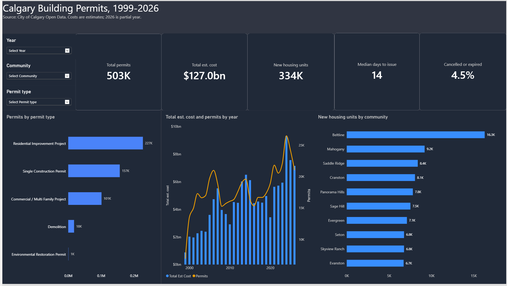
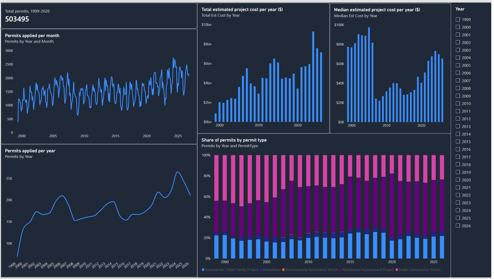
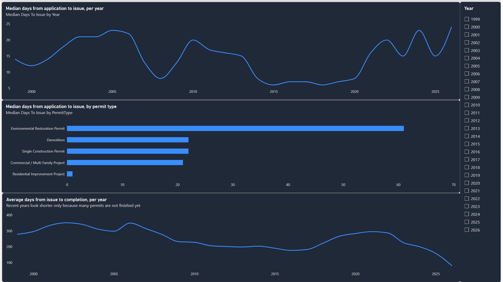
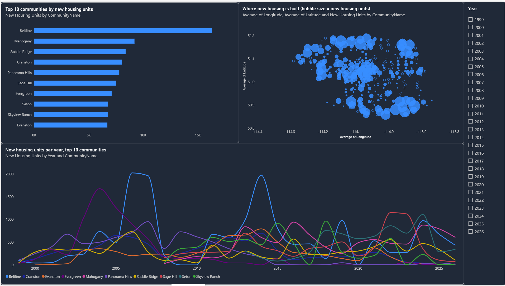
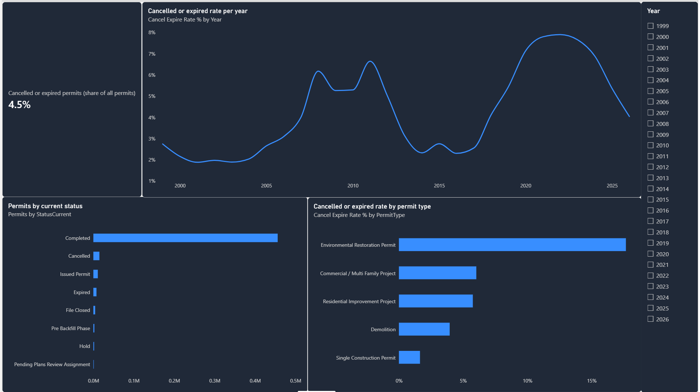
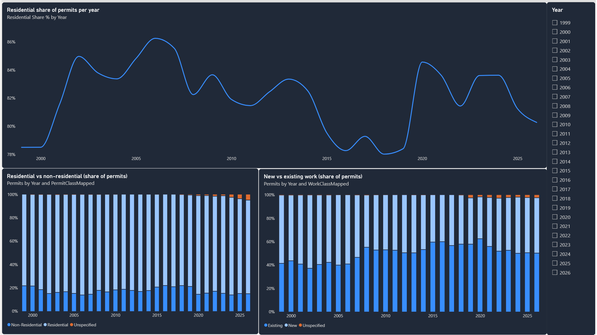

# Calgary Building Permits

Analysis of City of Calgary building permits (1999–2026, 503,495 records) following the Google Data Analytics process: **Ask → Prepare → Process → Analyze → Share → Act**. Data is profiled and cleaned with **pandas and numpy**; analysis and visuals are built in **Power BI with DAX**.

## Repository layout
| Path | Purpose |
|---|---|
| `scripts/profile_permits.py` | Prepare: profile the raw data |
| `scripts/clean_permits.py` | Process: clean the data for Power BI |
| `dax/measures.dax` | Analyze: calendar table and measures |
| `scripts/verify_findings.py` | Analyze: checks the Power BI numbers with pandas |
| `calgary_permits.pbix` | The Power BI report (28 MB, includes the cleaned data) |
| `images/` | Screenshots of the six report pages |
| `data/processed/building_permits_clean.zip` | The cleaned data (20 MB zipped, 503,495 rows, 20 columns) |
| `data/raw/` | Put the raw download here; git-ignored (330 MB, over GitHub's 100 MB limit) |

## Reproduce
**Quick start (cleaned data included):** unzip `data/processed/building_permits_clean.zip` in the same folder, then load the CSV in Power BI and add the DAX below.

**From the raw download:**
```bash
pip install -r requirements.txt            # pandas, numpy
# put Building_Permits_20261106.csv (City of Calgary Open Data) in data/raw/
python3 scripts/profile_permits.py
python3 scripts/clean_permits.py           # -> data/processed/building_permits_clean.csv
python3 scripts/verify_findings.py         # prints the numbers used in the findings
```
Then load the cleaned CSV in Power BI and add the DAX below.

---

## 1. Ask
**Business task:** describe how Calgary building permit volume, value and processing time have changed over time, by community and by permit type, for a city-planning / construction-industry audience.

**Questions:**
1. How have permit applications and total estimated project cost trended by year and month?
2. How long does it take from application to issuance, and from issuance to completion? Is it getting slower?
3. Which communities and permit types drive most new housing units?
4. What share of permits are cancelled or expired, and where/when is that highest?
5. How does the mix of residential vs non-residential and New vs Existing (renovation) work shift over time?
6. How do Calgary neighbourhoods grow? Which communities add the most new housing units and construction value over time, and which are newly emerging versus established?

**Success criteria:** each question is answered by at least one Power BI visual backed by a documented DAX measure.

## 2. Prepare
**Source:** City of Calgary Open Data – Building Permits, export `Building_Permits_20261106.csv` (503,495 rows, 30 columns, ~330 MB).

**Profile findings**
| Finding | Detail |
|---|---|
| Key | `PermitNum` is unique (0 duplicates) |
| Dates | text `yyyy/mm/dd`; applied 1999-06-22 → 2026-11-06; issued null 3.7%, completed null 3.9% |
| Money / area | `EstProjectCost` text like `"$246,090"` (7.8% null); `TotalSqFt` text like `"1,678"` (68.9% null) |
| Text nulls | `ApplicantName` 30.3%, `ContractorName` 39.8%, `Description` 9.0% (these columns are removed in Process) |
| Status | Completed 455,871; Cancelled 14,915; Issued Permit 11,000; Expired 7,654; File Closed 4,463; others small |
| Type | Residential Improvement 227,113; Single Construction 156,726; Commercial/Multi Family 101,200; Demolition 17,709; Environmental Restoration 747 |
| Bulky columns | `LocationsWKT`, `LocationsGeoJSON`, `Point`, `LocationAddresses`, `LocationTypes` are not needed (Latitude/Longitude kept) |
| Outliers | 8 negative costs; median cost $55,549, 99th percentile ≈ $2.35M |

**Limitations:** cost and square footage are applicant estimates, not actual spend; square footage is mostly missing; costs are not inflation-adjusted; missing issued/completed dates are legitimate for in-progress or cancelled permits.

Code used – `scripts/profile_permits.py`:
```python
# Step 2 (Prepare): look at the raw data before changing anything.
# Run from the project folder:  python3 scripts/profile_permits.py

import numpy as np
import pandas as pd

# Where the raw file is
raw_file = "data/raw/Building_Permits_20261106.csv"

# These columns are very long and we do not need them, so we skip them when loading
skip_columns = ["LocationsWKT", "LocationsGeoJSON", "Point", "LocationAddresses", "LocationTypes"]

# Load every column as text first (dtype=str) so pandas does not guess types.
# keep_default_na=False means the text "N/A" stays as text; only empty cells become missing.
df = pd.read_csv(
    raw_file,
    dtype=str,
    keep_default_na=False,
    na_values=[""],
    usecols=lambda name: name not in skip_columns,
)

# 1. How big is the table? (rows, columns)
print("Rows and columns:", df.shape)

# 2. Is every PermitNum unique?
print("Duplicate PermitNum:", df["PermitNum"].duplicated().sum())

# 3. How much is missing in each column, and how many different values does it have?
missing_percent = (df.isna().mean() * 100).round(1)
distinct_values = df.nunique()
print(pd.DataFrame({"missing_percent": missing_percent, "distinct_values": distinct_values}))

# 4. Count the values in the main category columns
for column in ["StatusCurrent", "PermitType", "PermitClassMapped", "WorkClassMapped"]:
    print(df[column].value_counts(dropna=False).head(8))
    print()

# 5. Earliest and latest date in each date column
for column in ["AppliedDate", "IssuedDate", "CompletedDate"]:
    dates = pd.to_datetime(df[column], format="%Y/%m/%d")
    print(column, "from", dates.min().date(), "to", dates.max().date())

# 6. Look at project cost. It is text like "$246,090", so remove "$" and "," first.
cost_text = df["EstProjectCost"].str.replace("$", "", regex=False).str.replace(",", "", regex=False)
cost = pd.to_numeric(cost_text)
print("Negative costs:", np.sum(cost < 0))
print(cost.quantile([0.5, 0.9, 0.99]))
```

## 3. Process
`scripts/clean_permits.py` writes `data/processed/building_permits_clean.csv`:
- keeps 20 of 30 columns. It drops the geometry/address-list columns and also `ApplicantName`, `ContractorName`, `Description` and `OriginalAddress`, so no names or street addresses are published (the licence gives no right to use personal information). Latitude and longitude, community and permit details are kept;
- converts dates to ISO `yyyy-mm-dd`;
- strips `$` and `,` from cost, square footage and housing units and converts them to numbers (whole numbers stay integers);
- title-cases `CommunityName`; fills blank `WorkClassMapped` with `Unspecified`;
- keeps literal `N/A` text (919 rows with `CommunityName`/`CommunityCode` = `N/A`);
- flags but does **not** drop 32 rows with dates out of order and 8 with negative cost — the DAX calculated columns ignore them.

Code used – `scripts/clean_permits.py`:
```python
# Step 3 (Process): clean the raw file and save a new file for Power BI.
# Run from the project folder:  python3 scripts/clean_permits.py

import numpy as np
import pandas as pd

# Where to read from and where to save
raw_file = "data/raw/Building_Permits_20261106.csv"
clean_file = "data/processed/building_permits_clean.csv"

# The columns we want to keep. We leave out the long location columns and also the
# names, free-text description and street address, so no personal or company details are shared.
keep_columns = [
    "PermitNum", "StatusCurrent", "AppliedDate", "IssuedDate", "CompletedDate",
    "PermitType", "PermitTypeMapped", "PermitClass", "PermitClassGroup", "PermitClassMapped",
    "WorkClass", "WorkClassGroup", "WorkClassMapped",
    "HousingUnits", "EstProjectCost", "TotalSqFt",
    "CommunityCode", "CommunityName", "Latitude", "Longitude",
]
date_columns = ["AppliedDate", "IssuedDate", "CompletedDate"]
number_columns = ["EstProjectCost", "TotalSqFt", "HousingUnits"]

# Step 1: load the file. Everything is loaded as text.
# keep_default_na=False keeps the text "N/A" (it is a real community name value).
df = pd.read_csv(
    raw_file,
    usecols=keep_columns,
    dtype=str,
    encoding="utf-8-sig",
    keep_default_na=False,
    na_values=[""],
)
df = df[keep_columns]  # put the columns in our order

# Step 2: remove extra spaces at the start and end of every text value
for column in keep_columns:
    df[column] = df[column].str.strip()

# Step 3: turn date text like "2013/07/08" into real dates
for column in date_columns:
    df[column] = pd.to_datetime(df[column], format="%Y/%m/%d")

# Step 4: turn text like "$246,090" into the number 246090
for column in number_columns:
    no_dollar = df[column].str.replace("$", "", regex=False)
    no_comma = no_dollar.str.replace(",", "", regex=False)
    df[column] = pd.to_numeric(no_comma)

# Step 5: make community names look the same (SADDLE RIDGE -> Saddle Ridge)
df["CommunityName"] = df["CommunityName"].str.title()

# Step 6: if WorkClassMapped is empty, write "Unspecified"
df["WorkClassMapped"] = np.where(df["WorkClassMapped"].isna(), "Unspecified", df["WorkClassMapped"])

# Step 7: count rows that look wrong. We keep them in the file; DAX will ignore them.
issued_before_applied = df["IssuedDate"] < df["AppliedDate"]
completed_before_issued = df["CompletedDate"] < df["IssuedDate"]
bad_dates = (issued_before_applied | completed_before_issued).sum()
negative_costs = (df["EstProjectCost"] < 0).sum()
print("Rows:", len(df))
print("Rows with dates in the wrong order:", bad_dates)
print("Rows with negative cost:", negative_costs)

# Step 8: save the clean file. float_format makes 246090.0 print as 246090.
df.to_csv(clean_file, index=False, date_format="%Y-%m-%d", float_format="%.15g")
print("Saved", clean_file)
```

## 4. Analyze
Load `building_permits_clean.csv` into Power BI as table `Permits` (dates = Date, cost/sqft = Fixed decimal, units = Whole number). Add the calendar table and calculated columns from the DAX below, then relate `Calendar[Date]` → `Permits[AppliedDate]` (active) and → `Permits[IssuedDate]` (inactive, used via `USERELATIONSHIP`).

| Question | Visuals in the report | Measures |
|---|---|---|
| 1 Trends | Line by month and by year, bars of total and median cost by year, 100% stacked permit types | `Permits`, `Total Est Cost`, `Median Est Cost` |
| 2 Processing time | Line by year, bar by permit type | `Median Days To Issue`, `Avg Days Issue To Complete` |
| 3 Communities | Top-10 bar, scatter of Latitude/Longitude sized by units | `New Housing Units`, `Community Rank` |
| 4 Outcomes | Bar by status, bar by permit type, line by year | `Cancel Expire Rate %` |
| 5 Mix | Line of residential share, 100% stacked by year | `Residential Share %`, `Permits` by `PermitClassMapped` and `WorkClassMapped` |
| 6 Neighbourhood growth | Line by year for the top 10 communities, top-10 bar, scatter | `New Housing Units`, `Community Rank`, `Community Share %` |

Code used – `dax/measures.dax`:
```dax
// DAX for Power BI. Tables: Permits (the cleaned CSV) and Calendar (made below).
// Relationships: Calendar[Date] -> Permits[AppliedDate]  (active)
//                Calendar[Date] -> Permits[IssuedDate]   (inactive)
// Do the parts in order: 1) Calendar, 2) calculated columns, 3) measures.


// ===== 1. CALENDAR TABLE (Modeling > New table) =====
Calendar =
ADDCOLUMNS (
    CALENDAR ( DATE ( 1999, 1, 1 ), DATE ( 2026, 12, 31 ) ),
    "Year", YEAR ( [Date] ),
    "Month Number", MONTH ( [Date] ),
    "Month", FORMAT ( [Date], "mmm" ),
    "Year-Month", FORMAT ( [Date], "yyyy-mm" )
)


// ===== 2. CALCULATED COLUMNS (Modeling > New column, in the Permits table) =====
// Days between applying and being issued.
// Rows with a missing date or dates in the wrong order are left blank.
Days To Issue =
IF (
    NOT ISBLANK ( Permits[IssuedDate] ) && Permits[IssuedDate] >= Permits[AppliedDate],
    DATEDIFF ( Permits[AppliedDate], Permits[IssuedDate], DAY )
)

// Days between being issued and being completed (same rules)
Days Issue To Complete =
IF (
    NOT ISBLANK ( Permits[CompletedDate] )
        && NOT ISBLANK ( Permits[IssuedDate] )
        && Permits[CompletedDate] >= Permits[IssuedDate],
    DATEDIFF ( Permits[IssuedDate], Permits[CompletedDate], DAY )
)

// Project cost, but negative costs are left blank
Valid Cost =
IF ( Permits[EstProjectCost] >= 0, Permits[EstProjectCost] )


// ===== 3. MEASURES (Modeling > New measure) =====

// --- How many permits ---
Permits = DISTINCTCOUNT ( Permits[PermitNum] )

Permits Last Year = CALCULATE ( [Permits], SAMEPERIODLASTYEAR ( 'Calendar'[Date] ) )

Permits YoY % = DIVIDE ( [Permits] - [Permits Last Year], [Permits Last Year] )

// --- How much money ---
Total Est Cost = SUM ( Permits[Valid Cost] )

Average Est Cost = AVERAGE ( Permits[Valid Cost] )

Median Est Cost = MEDIAN ( Permits[Valid Cost] )

// --- Housing ---
Housing Units = SUM ( Permits[HousingUnits] )

New Housing Units =
CALCULATE (
    [Housing Units],
    Permits[WorkClassMapped] = "New",
    Permits[PermitClassMapped] = "Residential"
)

// --- How long it takes ---
Avg Days To Issue = AVERAGE ( Permits[Days To Issue] )

Median Days To Issue = MEDIAN ( Permits[Days To Issue] )

Avg Days Issue To Complete = AVERAGE ( Permits[Days Issue To Complete] )

// --- Cancelled or expired ---
Cancelled Or Expired =
CALCULATE ( [Permits], Permits[StatusCurrent] IN { "Cancelled", "Expired" } )

Cancel Expire Rate % = DIVIDE ( [Cancelled Or Expired], [Permits] )

// --- Mix and communities ---
Residential Share % =
DIVIDE ( CALCULATE ( [Permits], Permits[PermitClassMapped] = "Residential" ), [Permits] )

// Share of all permits that are in the community on the visual
Community Share % =
DIVIDE ( [Permits], CALCULATE ( [Permits], ALL ( Permits[CommunityName] ) ) )

// 1 = community with the most permits
Community Rank = RANKX ( ALL ( Permits[CommunityName] ), [Permits], , DESC )
```

Code used – `scripts/verify_findings.py` (the same rules as the DAX, used to check the numbers below):
```python
# Step 4 (Analyze): check the Power BI numbers with pandas.
# The definitions match the DAX measures in dax/measures.dax.
# Run from the project folder:  python3 scripts/verify_findings.py

import numpy as np
import pandas as pd

df = pd.read_csv(
    "data/processed/building_permits_clean.csv",
    parse_dates=["AppliedDate", "IssuedDate", "CompletedDate"],
)
df["Year"] = df["AppliedDate"].dt.year

# Same rules as the DAX calculated columns
df["DaysToIssue"] = (df["IssuedDate"] - df["AppliedDate"]).dt.days
df.loc[df["DaysToIssue"] < 0, "DaysToIssue"] = np.nan
df["DaysIssueToComplete"] = (df["CompletedDate"] - df["IssuedDate"]).dt.days
df.loc[df["DaysIssueToComplete"] < 0, "DaysIssueToComplete"] = np.nan
df["ValidCost"] = df["EstProjectCost"].where(df["EstProjectCost"] >= 0)

print("=== Q1: permits and cost per year ===")
by_year = df.groupby("Year").agg(
    permits=("PermitNum", "count"),
    total_cost_bn=("ValidCost", lambda s: round(s.sum() / 1e9, 2)),
    median_cost=("ValidCost", "median"),
    average_cost=("ValidCost", lambda s: round(s.mean())),
)
print(by_year)

print("=== Q2: days to issue ===")
print("Overall median days to issue:", df["DaysToIssue"].median())
print("Share issued same day (%):", round((df["DaysToIssue"] == 0).mean() * 100, 1))
print(df.groupby("PermitType")["DaysToIssue"].agg(["median", "mean", "count"]).round(1))
print(df.groupby("Year")["DaysToIssue"].median().loc[[2000, 2005, 2010, 2015, 2020, 2023, 2024, 2025]])
print("Avg days issue to complete by year:")
print(df.groupby("Year")["DaysIssueToComplete"].mean().round(0).loc[[2000, 2005, 2010, 2015, 2020, 2022, 2023, 2024, 2025]])

print("=== Q3 and Q6: communities and new housing ===")
new_homes = df[(df["WorkClassMapped"] == "New") & (df["PermitClassMapped"] == "Residential")]
print("Top 10 communities by permits:")
print(df.groupby("CommunityName").size().sort_values(ascending=False).head(10))
print("Top 10 communities by new housing units (all years):")
print(new_homes.groupby("CommunityName")["HousingUnits"].sum().sort_values(ascending=False).head(10))
recent = new_homes[new_homes["Year"].between(2021, 2025)].groupby("CommunityName")["HousingUnits"].sum()
print("Top 10 communities by new housing units 2021-2025:")
print(recent.sort_values(ascending=False).head(10))
first_year = new_homes.groupby("CommunityName")["Year"].min()
newest = first_year[first_year >= 2015].index
print("Communities whose first new housing permit is 2015 or later:", len(newest))
print(new_homes[new_homes["CommunityName"].isin(newest) & new_homes["Year"].between(2021, 2025)]
      .groupby("CommunityName")["HousingUnits"].sum().sort_values(ascending=False).head(8))
share_top10 = recent.sort_values(ascending=False).head(10).sum() / recent.sum() * 100
print("Top 10 share of 2021-2025 new units (%):", round(share_top10, 1))

print("=== Q4: outcomes ===")
print((df["StatusCurrent"].value_counts(normalize=True) * 100).round(1).head(6))
df["CancelledOrExpired"] = df["StatusCurrent"].isin(["Cancelled", "Expired"])
print("Cancel/expire rate (%):", round(df["CancelledOrExpired"].mean() * 100, 1))
print((df.groupby("PermitType")["CancelledOrExpired"].mean() * 100).round(1))
print((df.groupby("Year")["CancelledOrExpired"].mean() * 100).round(1).loc[[2000, 2005, 2010, 2015, 2020, 2023, 2024, 2025]])

print("=== Q5: mix ===")
mix = df.groupby("Year").agg(
    residential_pct=("PermitClassMapped", lambda s: round((s == "Residential").mean() * 100, 1)),
    new_work_pct=("WorkClassMapped", lambda s: round((s == "New").mean() * 100, 1)),
)
print(mix.loc[[2000, 2005, 2010, 2015, 2020, 2025]])

print("=== Cost mix effect (2006 vs 2007) ===")
for year in [2006, 2007]:
    part = df[df["Year"] == year]
    print(year, (part["PermitType"].value_counts(normalize=True) * 100).round(1).to_dict())
    print(year, part.groupby("PermitType")["ValidCost"].median().round(0).to_dict())
```

### Findings
Numbers come from `scripts/verify_findings.py` on the cleaned file and match the Power BI report. "Year" means the year the permit was applied for. Each question is answered on a page of `calgary_permits.pbix`; see the screenshots under Share.

**Q1. How have permits and estimated cost trended?**
- Applications grew from 6,991 in 1999 (a partial year, the data starts in June) to a record **26,521 in 2024**. 2025 had 24,208 and 2026 has 21,092 so far (to 6 November).
- Volume dipped after 2006 (21,007 → 15,268 in 2008) and again in 2015–2016 (about 16,000 and 15,400), and fell in 2020 (18,907) before recovering to 21,834 in 2021.
- Total estimated cost peaked at **$9.29 billion in 2024** (2025: $7.56 bn; 2026 so far: $7.14 bn). 2024 combined record volume with a high average cost ($397K, against a median of $73K), so a minority of large projects pulls the total up. Costs are not adjusted for inflation.
- **The median cost fell from $81.8K in 2006 to $24.3K in 2007, but this is a change in the mix, not in prices.** Cheap Residential Improvement permits grew from 38.6% of permits (2006) to 46.0% (2007) and 51.8% (2008), while Single Construction fell from 41.4% to 33.5% and 25.2%. Inside each type the median did not fall: Single Construction $167K → $212K, Commercial / Multi Family $72K → $85K, Residential Improvement $11.5K → $11.0K.

**Q2. How long do permits take?**
- The overall median is **14 days** from application to issue, and 20.9% of permits are issued the same day.
- By type: Residential Improvement **1 day** (217,257 permits), Commercial / Multi Family 21, Single Construction 22, Demolition 22, Environmental Restoration 61 (only 617 permits).
- The median wait changed a lot over time: 23 days (2005) → 6 (2015) → 8 (2020) → **23 (2024)** → 15 (2025).
- Time from issue to completion averages 159–296 days by year, but the most recent years look shorter only because many of their permits are not finished yet. Do not read that as an improvement.

**Q3. Which communities and permit types drive new housing?**
- Most permits: Downtown Commercial Core (14,812), Saddle Ridge (11,495), Cranston (10,749), Panorama Hills (10,473), Mahogany (9,958).
- Most new housing units, all years: **Beltline 16,307**, far ahead of Mahogany (9,206), Saddle Ridge (8,396), Cranston (8,069) and Panorama Hills (7,815). Downtown Commercial Core has many permits but is not in the top 10 for new housing units.

**Q4. How many permits are cancelled or expired?**
- 90.5% of permits are completed; **4.5%** are cancelled (3.0%) or expired (1.5%).
- By type: Single Construction 1.6%, Demolition 4.0%, Residential Improvement 5.8%, Commercial / Multi Family 6.0%, Environmental Restoration 17.7% (small group).
- By year: 2.2% (2000), 2.7% (2005), 5.3% (2010), 2.8% (2015), 5.4% (2019), 7.1% (2020), 7.8% (2021), **7.9% (2022, the peak)**, 7.7% (2023), 6.9% (2024), 5.4% (2025), 4.0% (2026 so far). Permits from recent years can still change status.

**Q5. How does the mix change?**
- Residential permits stay at about 78–85% of all permits in every period checked.
- The share of **New** work (versus Existing / renovation) fell from 60.3% (2005) to 47.2% (2010), 40.6% (2015) and a low of 35.9% (2020), then rose to 47.3% (2025).

**Q6. How do neighbourhoods grow?**
- New housing units, 2021–2025: Cornerstone 3,676, Seton 3,591, Mahogany 3,164, Sage Hill 3,112, Livingston 3,111, Carrington 2,934, Springbank Hill 2,760, Beltline 2,733, Belmont 2,255, Legacy 2,208. These ten make up **32.8%** of all new units in those years.
- Growth has moved outward. Saddle Ridge, Cranston and Panorama Hills lead over all years, but 31 communities had their first new-housing permit in 2015 or later, and several of them now lead: Cornerstone, Livingston, Carrington, Belmont and Rangeview (2,125 units).

## 5. Share
The report is `calgary_permits.pbix`. Open it with Power BI Desktop (Windows only). It has six pages. The Overview page has Year, Community and Permit type slicers; the others have a Year slicer. The tables and measures are the ones in `dax/measures.dax`.

| Page | Answers | Screenshot |
|---|---|---|
| Overview | Headline numbers, permit types, cost and volume by year, top communities |  |
| Trends | Q1 permits and cost over time |  |
| Processing time | Q2 days to issue and to complete |  |
| Communities | Q3 and Q6 where new housing is built |  |
| Outcomes | Q4 cancelled and expired permits |  |
| Mix | Q5 residential share and new vs existing work |  |

**Limits to state when presenting**
- Costs and square footage are applicant estimates and are not adjusted for inflation.
- The first year (1999, from June) and the last year (2026, to 6 November) are partial.
- Issue-to-completion times and recent cancellation rates are incomplete for recent permits, because many are not finished yet.
- The overall median cost mixes permit types that differ greatly in size.
- The report is built from the cleaned file, which has no applicant, contractor, description or street-address columns.

## 6. Act
Suggestions that follow from the findings above:
1. **Compare costs within a permit type**, not as one overall median, because the mix of permit types changes the overall number (Q1).
2. **Look into the rise in waiting time.** The median days to issue went from 6 (2015) to 23 (2024). Check the types of permit behind it, using `Median Days To Issue` by `PermitType` and year (Q2).
3. **Plan services for fast-growing newer communities** such as Cornerstone, Seton, Livingston, Carrington and Belmont (Q6).
4. **Study cancellations of Residential Improvement and Commercial / Multi Family permits.** They sit near 6%, and the overall rate was 6.9–7.9% in 2020–2024 against 2.8% in 2015 (Q4).
5. **Improve the data next time.** Adjust costs for inflation, and exclude permits applied for in the last few years when measuring completion time (Q1, Q2).

---
Contains information licensed under the [Open Government Licence – City of Calgary](https://data.calgary.ca/d/Open-Data-Terms/u45n-7awa). Data: Building Permits, The City of Calgary (Dev Business and Bldg Srvc), https://data.calgary.ca. This project is not affiliated with or endorsed by The City of Calgary.
